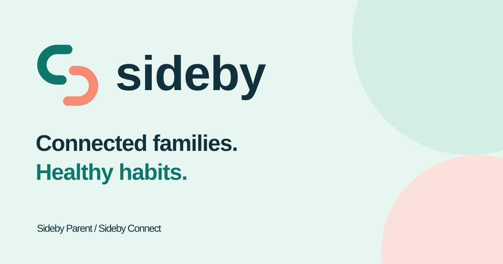
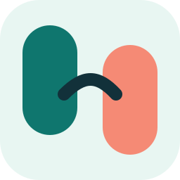

# Sideby


Connected families. Healthy habits.

Sideby helps parents manage multiple children and their devices through a shared parent account on web and, later, mobile. The child companion is **Sideby Connect**. The parent experience is **Sideby Parent**.

## Status

The parent web app now uses Neon for real accounts, family profiles, routines, private profile photos and live updates across signed-in browsers. It supports multiple children, unrestricted usage by default, archive/restore, family settings and JSON export. Its minimal responsive interface works on desktop and mobile browsers.

**This is a connected early-access foundation, not a finished parental-control release.** Routines are saved preferences only. Child creation has no allowance field. Each child has a direct Child’s Space URL with dedicated sections; pause and media actions remain unavailable until a device is connected. The web pairing flow now supports expiring codes, parent confirmation, multiple devices, check-in status and credential revocation. Enforcement, requests from devices, location and live screen/camera/microphone sessions still depend on the future Android companion. See [device pairing](docs/PAIRING.md) for the contract and test workflow. Co-parent invitations, account deletion, launch hardening and the separate landing website remain pending.
## Structure

- `apps/parent-web/`: parent dashboard, built first.
- `apps/website/`: separate public landing website.
- `apps/child-android/`: future Android companion.
- `apps/parent-mobile/`: future parent mobile client.
- `packages/ui/`: future shared web components.
- `assets/brand/`: editable SVG brand assets and color tokens.
- `docs/`: product, architecture, security, roadmap, and delivery guidance.

## Technology

Next.js and TypeScript for both websites; Tailwind CSS for styling; Neon Postgres for family data; Vercel for web hosting; Kotlin for the Android companion. Neon Auth manages web sessions; native mobile authentication still needs a compatibility milestone. LiveKit is the candidate for visible, authorized live media sessions, subject to a real-device feasibility milestone.

## Start here

1. Read [product requirements](docs/PRD.md), [architecture](docs/ARCHITECTURE.md), and [roadmap](docs/ROADMAP.md).
2. Follow [contribution guidance](CONTRIBUTING.md) and [Git workflow](docs/GIT_WORKFLOW.md).
3. Follow [AI instructions](AGENTS.md) when using coding assistants.

## Run the parent dashboard

Use Node.js 22 or newer (validated locally with Node.js 24).

```sh
npm ci
npx neon@latest deploy
# Follow docs/NEON_SETUP.md to prepare the app environment and schema.
npm run dev
```

Open http://127.0.0.1:3000. Create a parent account and a family. Environment setup is required; see [Neon setup](docs/NEON_SETUP.md).

```sh
npm run build
npm run typecheck
```

The landing website remains a separate reserved directory. Configuration names are in `.env.example`; never commit real secrets.

See [API contracts](docs/API.md) and [verification results](docs/VERIFICATION.md).

## Sample data for testing

Create your parent account, then follow [sample-data setup and cleanup](docs/DEMO_DATA.md). The optional seed adds three demo children and three routines without overwriting your existing records.

## Brand assets



| Sideby Parent | Sideby Connect |
| --- | --- |
|  |  |

The logo uses two open links that form an abstract **S**, representing family members side by side. The kit includes light/dark logos, product lockups, distinct app icons, monochrome symbols, a favicon, a social banner, and a background pattern.

Browse the [asset guide](assets/brand/README.md) or open [the brand gallery](assets/brand/preview.html) locally. SVG sources stay editable; native mobile and raster social exports will be added during integration.

## Brand and domain

Sideby is the selected working brand. Trademark and domain availability have not been verified. `sideby.omprakashbharti.in` is the intended landing address; deployment and DNS are not configured. A parent dashboard subdomain remains to be configured.

## Ownership

No open-source license is granted by this repository. See [license status](LICENSE.md).
