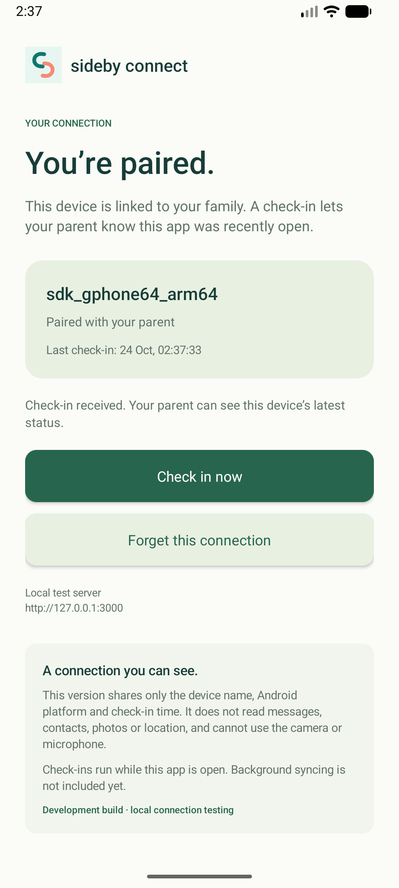
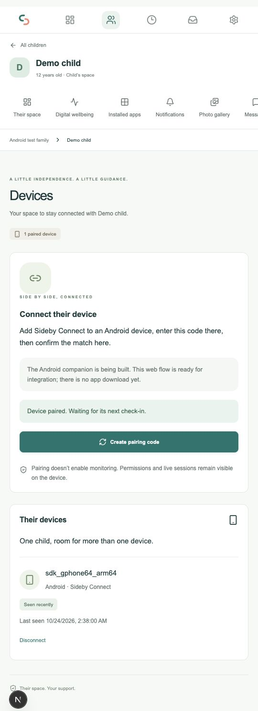
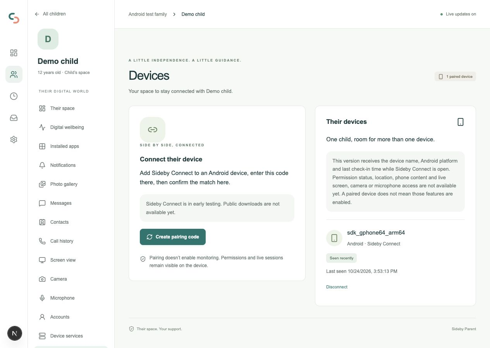

# Android connection milestone

Sideby Connect now has a runnable native Kotlin app. Scope: visible installation, pairing-code entry, matching confirmation fingerprint, parent approval, secure storage, foreground heartbeat, reconnect and revocation handling. No backend contract or schema change is required.

## Local topology

Android emulator or USB test phone → adb reverse port 3000 → local Sideby Parent → configured Neon services. The web backend is not publicly deployed. The public landing website has no role in device pairing. The debug-only local HTTP allowance is not present in release resources; normal HTTPS certificate validation remains enabled.

## Expected states

| State | Companion | Parent |
| --- | --- | --- |
| No connection | Server/device name/code form | Can create a pairing offer |
| Pending | Matching confirmation fingerprint, waiting for parent | Pending device claim and confirmation control |
| Approved | Check-in time and manual check-in | Separate device record and last seen |
| Network unavailable | Retains encrypted credential and retries while open | Last-seen state becomes stale |
| App closed | No background check-ins | Last-seen time remains authoritative |
| Revoked/expired/archived | Next authenticated 401 clears session and requests re-pairing | Credential cannot update device |
| Forgotten locally | Local session removed, check-ins stopped | Parent still needs to revoke/cancel the record |

A successful connection proves the identity/check-in path only. It does not grant content permissions, collect phone data or enable pause/media actions.

## Verification

Verified 24 October 2026 with synthetic fixtures, Android API 37 ARM64 emulator and the parent server at localhost:3000 (configured Neon backend):

- Debug APK and unsigned release APK built successfully; five policy unit tests and Android lint passed. The checksum-pinned wrapper also ran unit tests and lint successfully.
- Local Postman simulation: actual app heartbeat returned 401, claim returned 200 and the app displayed pending approval. This simulation proves only the pending flow.
- Real integration: parent and app confirmation fingerprints matched; approval produced a paired device and successful check-in on both screens.
- Force-stop/relaunch restored the encrypted session and resumed check-ins.
- Removing adb forwarding showed the unreachable-server state while preserving the connection; restoring forwarding recovered check-ins.
- Parent disconnect invalidated the next check-in; Android cleared its stored credential and returned to pairing.
- Debug app private preferences contained only an encrypted value, without plaintext session fields; after revocation the value was absent.

The root web build and type checks also passed. Synthetic test accounts and their family data were removed after testing.

Physical phones, API 26–36, background syncing, battery behavior, accessibility and credential-expiry timing are not validated by these checks. The existing backend security suite separately covers pairing expiry and family isolation. No content permission or monitoring behavior is implemented.

## Next milestones

Test a real Android phone and older supported Android versions; decide background check-in design and battery tradeoffs; establish device credential renewal and recovery; then implement each additional permission-based capability independently. Minimum build API is 26, but a build setting alone is not a tested support matrix.

## Repeat installation and pairing audit

Repeated on 24 October 2026 after the initial PR, using a newly created synthetic family and pairing code:

- Reinstalled the debug APK on API 37; entered the fresh code in the Android UI.
- Both screens displayed the same confirmation fingerprint; approved in the parent browser.
- Android displayed paired/check-in received; the local parent dashboard displayed one device, Seen recently and a new last-seen timestamp.
- Audited the Android manifest, request payloads and parent heartbeat implementation: only INTERNET is declared. The app sends device name/platform during claim and its credential during heartbeat; the server records the check-in time. No runtime permission checklist, permission-status upload, phone content, location or live media is implemented.
- Found and corrected a stale success message that continued to say waiting for a check-in after one had arrived. The Devices page now explicitly explains the data available in this version.

The requested full onboarding flow is **not complete**. It must distinguish device pairing, individual permission decisions, collection/sync success and active media sessions. Runtime permissions should be requested in context for implemented features, remain optional and reflect revocation. Accessibility and device-admin activation are separate mechanisms, not blanket grants. Screen sharing requires Android consent for each session, not a permanent setup checkbox. See Android's [permission guidance](https://developer.android.com/training/permissions/requesting) and [media projection guidance](https://developer.android.com/media/grow/media-projection).

Repeat-test evidence: 

The manual check-in advanced last-seen time again. Root web build and type checks passed after the status-copy correction.
